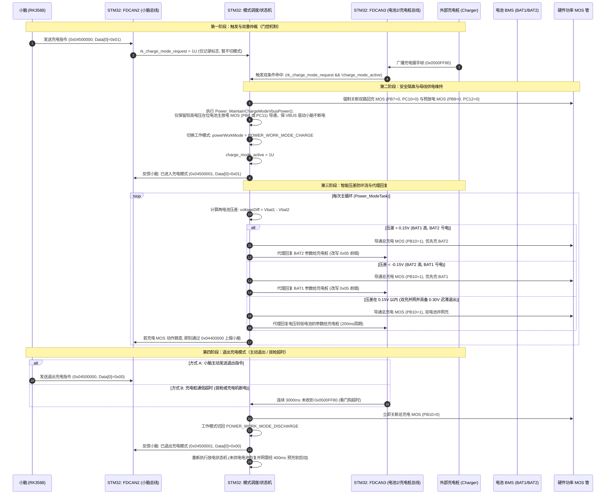
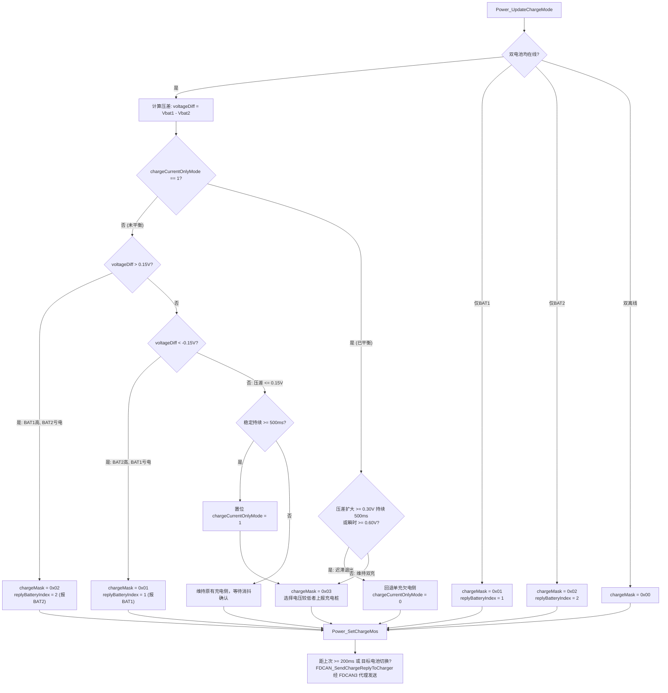

# D-Y 双电池系统充电控制逻辑与协议交互分析

本文档详细梳理 D-Y 双电池智能电源管理系统的当前充电逻辑，重点分析**检测到充电桩 CAN 消息和小脑充电指令后的全套软硬件响应时序、安全保护与状态机流转机制**。

- **适用硬件版本**：V1.2 / V1.3（当前主板原理图）
- **适用固件版本**：v1.2.1+（支持无缝热接力、充电保电与超时看门狗）
- **核心控制器**：STM32G474RBT6（ARM Cortex-M4 @ 170MHz）

---

## 1. 系统角色与通信拓扑

系统涉及三方协同与三路独立 FDCAN 总线（经典 CAN 模式，250kbps）：

```
                           +-------------------------------------+
                           |            上位机 / 小脑             |
                           |              (RK3588)               |
                           +-------------------------------------+
                                              ^
                                              | FDCAN2 (250kbps)*
                                              | 指令下发 / 状态遥测 / IAP升级
                                              v
+------------------+       +-------------------------------------+       +-------------------+
|   电池包 1 BMS    | <---> |            STM32G474RBT6            | <---> |    外部充电桩     |
|     (BAT1)       | FDCAN1|          (双电池电源管理控制器)        | FDCAN3|     (Charger)     |
+------------------+       +-------------------------------------+       +-------------------+
                                              ^
                                              | FDCAN3 (250kbps)*
                                              v
                                   +---------------------+
                                   |     电池包 2 BMS    |
                                   |       (BAT2)        |
                                   +---------------------+
```

> **特别说明（FDCAN2 / FDCAN3 职责对调）**：  
> 硬件 V1.2 及以上 PCB 走线时，将外部接口的 CAN2 与 CAN3 走线反接。为确保硬件引脚复用与软件协议匹配，固件在驱动层实施了对调：  
> - **FDCAN2**（物理引脚 `PB5`/`PB13`）：软件作为**上位机 / RK3588 小脑通信总线**；  
> - **FDCAN3**（物理引脚 `PA8`/`PB4`）：软件作为**电池 2 BMS 与外部充电桩通信总线**。

### 1.1 CAN 总线定义
1. **FDCAN1**（`PA11` RX / `PA12` TX）：专用于连接 **电池 1 (BAT1) BMS**，周期发送唤醒帧（`0x0400FF80`），接收 BAT1 内部参数（总压、电流、SOC、电芯温度、BMS MOS 状态）。
2. **FDCAN2**（`PB5` RX / `PB13` TX）：对接 **上位机 / 小脑 (RK3588)**，接收充放电控制指令（`0x04500000`）、声光面板控制（`0x04600000`）及 IAP 升级请求（`0x04700000`），并向小脑上报电源板各路 MOS 状态与系统告警（`0x04400000`）。
3. **FDCAN3**（`PA8` RX / `PB4` TX）：共用总线，同时挂载 **电池 2 (BAT2) BMS** 与 **外部充电桩 (Charger)**。STM32 在此总线上接收 BAT2 BMS 参数、监听充电桩广播握手帧（`0x0500FF80`），并向充电桩代理回复电池参数。

### 1.2 硬件 MOS 与控制引脚映射
在 V1.2 / V1.3 硬件设计中，双电池采用“独立放电/预放电/回充 + 单路总充电输入”的拓扑架构：

- **单路总充电 MOS**：`PB10` (`BAT_CHARGE_MOS_Pin` / `O_Bat_C_G`)，高电平导通，直通主母线 VBUS。  
  *(固件已统一使用单路 `BAT_CHARGE_MOS_Pin` 控制，当任意一路充电需求激活时导通 PB10)*
- **BAT1 主放电 MOS**：`PB6` (`BAT1_DISCHARGE_MOS_Pin` / `O_Bat1_D_DSG`)，高电平导通。
- **BAT1 回充 MOS**：`PB7` (`BAT1_RECHARGE_MOS_Pin` / `O_Bat1_D_CHG`)，高电平导通。
- **BAT1 预放电 MOS**：`PB9` (`BAT1_PRE_DISCHARGE_MOS_Pin` / `O_Bat1_D_PDSG`)，高电平导通（串限流电阻缓冲）。
- **BAT2 主放电 MOS**：`PC11` (`BAT2_DISCHARGE_MOS_Pin` / `O_Bat2_D_DSG`)，高电平导通。
- **BAT2 回充 MOS**：`PC10` (`BAT2_RECHARGE_MOS_Pin` / `O_Bat2_D_CHG`)，高电平导通。
- **BAT2 预放电 MOS**：`PC12` (`BAT2_PRE_DISCHARGE_MOS_Pin` / `O_Bat2_D_PDSG`)，高电平导通（串限流电阻缓冲）。
- **外设供电 MOS**：`PA5` (`PERIPHERAL_POWER_Pin` / `O_Peripheral_G`)，高电平导通。
- **12V 隔离 DCDC 使能**：`PA7` (`DCDC_EN_12V_Pin` / `O_Enable_12V`)，低电平有效（维持小脑 RK3588 供电）。
- **24V 隔离 DCDC 使能**：`PC4` (`DCDC_EN_24V_Pin` / `O_Enable_24V`)，低电平有效（为外部 RGB 状态面板与蜂鸣器供电）。
- **反电势泄放回路 (TIM8 互补 PWM)**：`PB0` (`TIM8_CH2N`, 泄放 1) 与 `PC7` (`TIM8_CH2`, 泄放 2)，交替斩波泄放。
- **板载 3.3V 状态指示灯 (V1.3)**：`PB1` (LED2 心跳指示) 与 `PB2` (LED3 动力状态指示)。

---

## 2. 充电逻辑全时序流程

当小脑下发指令且外部充电桩接入时，系统的完整动作时序如下：



---

## 3. 核心机制详细剖析

### 3.1 步骤一：触发与双重仲裁（门控机制）

代码位置：[`Core/Src/fdcan.c`](file:///home/yq/ghf/workspace/D-Y-A10/Core/Src/fdcan.c#L886-L963)

1. **小脑请求记录**：  
   小脑通过 **FDCAN2** 发送扩展帧 `0x04500000U`（`FDCAN_RK_CHARGE_MODE_CMD_ID`），字节 0 为 `0x01`（`FDCAN_CHARGE_MODE_ENTER`）。  
   [`FDCAN_HandleRkChargeModeCommand()`](file:///home/yq/ghf/workspace/D-Y-A10/Core/Src/fdcan.c#L940-L963) 解析后，仅将请求标志位置位：
   ```c
   rk_charge_mode_request = 1U;
   ```
   > **关键设计考量**：收到小脑指令后**绝不直接开通充电硬件**。防止在充电枪未物理连接、充电桩未通电或通信异常时产生空载漏电或高压风险。

2. **充电桩握手帧检测**：  
   外部充电桩在 **FDCAN3** 总线上广播握手指令：`0x0500FF80U` (`FDCAN_CHARGE_MODE_CMD_ID`)。  
   STM32 的 FDCAN3 硬件过滤器捕获该 ID，并在接收中断中更新最近通信时间戳 `charger_can_last_rx_tick`。

3. **双重仲裁命中切入**：  
   在 [`FDCAN_PollBatteryRx()`](file:///home/yq/ghf/workspace/D-Y-A10/Core/Src/fdcan.c#L898-L920) 中，当从 FDCAN3 收到充电桩握手帧时进行联合校验：
   ```c
   if ((hfdcan->Instance == FDCAN3) &&
       (rxHeader.IdType == FDCAN_EXTENDED_ID) &&
       (rxHeader.Identifier == FDCAN_CHARGE_MODE_CMD_ID))
   {
     charger_can_last_rx_tick = now;
     if ((rk_charge_mode_request != 0U) && (charge_mode_active == 0U))
     {
       if (Power_EnterChargeMode() == HAL_OK)
       {
         charge_mode_active = 1U;
         FDCAN_SendChargeModeStatusToRk(FDCAN_CHARGE_MODE_ENTER);
       }
     }
     continue;
   }
   ```
   - 只有“小脑已下发充电指令” 且 “外部充电桩通信就绪” 时，系统才切入充电模式；
   - 切入成功后，通过 FDCAN2 向小脑回复扩展帧 `0x04500001U`（`Data[0] = 0x01`），通知上位机底盘已正式进入充电状态。

---

### 3.2 步骤二：切入充电与母线单路保电机制（`Power_EnterChargeMode`）

代码位置：[`Core/Src/gpio.c`](file:///home/yq/ghf/workspace/D-Y-A10/Core/Src/gpio.c#L569-L646)

在切入充电模式的瞬间，系统既要确保充电回路安全，又要保障主控小脑（RK3588）持续运行不断电：

1. **彻底关闭所有回充与预放电路径**：
   - 电池 1 回充 MOS (`PB7`) -> OFF
   - 电池 2 回充 MOS (`PC10`) -> OFF
   - 电池 1 预放电 MOS (`PB9`) -> OFF
   - 电池 2 预放电 MOS (`PC12`) -> OFF
   - 释放预放电互斥索引：`powerPreDischargeBatteryIndex = 0U`
   - *目的*：杜绝高压电池通过回充支路对低压电池产生无序倒灌环流，同时消除预放电阻长期承受母线电压的发热损坏风险。

2. **【核心安全创新】维持单路在位电池主放电 MOS 保 VBUS 供电与迟滞防抖（`Power_MaintainChargeModeVbusPower`）**：
   四足机器人的小脑（RK3588）、激光雷达及板载控制系统均依赖母线 VBUS 经 12V 隔离 DCDC（`PA7`）供电。若在充电时将所有放电 MOS 全部切断，拔插充电枪或充电桩启动建立电压期间，母线将瞬间失电导致小脑掉电崩溃。
   系统通过独创的**单路互斥放电保电与 0.3V 迟滞回差策略**：
   ```c
   /* 维持单路在位且 BMS 允许放电的电池主放电 MOS 导通，严禁双路同时导通 */
   /* 迟滞回差 (0.3V)：当前供电电池优先，另一侧电池高出 0.3V 以上才切换，杜绝 0.0V 边界交替跳切 */
   if (bat1CanSupply && bat2CanSupply)
   {
     if (battery1Control.state == POWER_BATTERY_STATE_DISCHARGE)
     {
       selectBat1 = ((v2 - v1) > POWER_CHARGE_VBUS_HYSTERESIS_VOLTAGE) ? 0U : 1U;
     }
     else if (battery2Control.state == POWER_BATTERY_STATE_DISCHARGE)
     {
       selectBat1 = ((v1 - v2) > POWER_CHARGE_VBUS_HYSTERESIS_VOLTAGE) ? 1U : 0U;
     }
     else
     {
       selectBat1 = (v1 >= v2) ? 1U : 0U;
     }
   }
   ```
   - **单路供电**：仅维持一路电池主放电 MOS 导通，保障 VBUS 持续输出，小脑不重启；
   - **0.3V 迟滞回差**：优先维持当前正在供电的电池，只有当另一块电池电压高出当前电池超过 `0.30V`（`POWER_CHARGE_VBUS_HYSTERESIS_VOLTAGE`）时才执行平滑切换，彻底杜绝电压接近时放电 MOS 的交替硬切抖动；
   - **严禁双导通**：另一路电池主放电 MOS 强制切断（置为 `POWER_BATTERY_STATE_OFF`），杜绝两块电池在 VBUS 母线上硬并联产生跨电池大电流倒灌短路环流；
   - 处于待机状态的电池，在后续退出充电恢复并网时，必须按规程重新执行 400ms 预充软启动。

3. **重置充电状态机与时钟**：
   - `powerWorkMode = POWER_WORK_MODE_CHARGE`
   - `chargeCurrentOnlyMode = 0U`（充电压差平衡标志重置）
   - 初始化代理回复时钟：`chargeReplyLastTxTick = HAL_GetTick() - POWER_CHARGE_REPLY_PERIOD_MS`，确保切入充电后立即向充电桩回复第一包电池状态。

---

### 3.3 步骤三：智能压差防环流与充电控制（`Power_UpdateChargeMode`）

代码位置：[`Core/Src/gpio.c`](file:///home/yq/ghf/workspace/D-Y-A10/Core/Src/gpio.c#L691-L772)

在主循环中，[`Power_ModeTask()`](file:///home/yq/ghf/workspace/D-Y-A10/Core/Src/gpio.c#L545-L567) 轮询执行。当前模式为 `POWER_WORK_MODE_CHARGE` 时，执行智能充电算法：



#### 算法策略详解：
- **阈值基准与双向迟滞（Symmetric Hysteresis）**：
  - 进入并联充电压差阈值：`POWER_CHARGE_BALANCE_ENTER_DIFF = 0.15V`（略高于 0.10V LSB 采样步长，彻底消除采样离散跳动）；
  - 迟滞退出并联压差阈值：`POWER_CHARGE_BALANCE_EXIT_DIFF = 0.30V`（若并联充电中两电池压差再次扩大至 0.30V 以上，自动回退至单充欠电侧，防止并联偏流）。
- **压差大（>0.15V）**：高压电池向低压电池充电会产生巨大的并联环流。系统开启欠电侧电池的回充与放电 MOS，彻底断开高电侧电池的全部 MOS 防止倒灌，并向充电桩代理汇报欠电侧参数；
- **压差平衡消抖确认（≤0.15V 且稳定持续 500ms）**：压差缩小至 0.15V 并在 500ms 持续时间窗口内保持稳定，`chargeCurrentOnlyMode` 置 1，进入双充并网快充；消抖等待期间保持原有充电侧，杜绝 0.0V 零点高频跳切。
- **动态选优上报**：在双充状态下，系统自动挑选**当前电压较低**的那块电池作为数据源向充电桩汇报，使充电桩按照欠电电池的最佳曲线恒流输出，防止提前降流。
- **MOS 物理协同驱动（`Power_SetChargeMos`）**：
  - 单充 BAT1 (`0x01`)：开启 PB10（总充）、PB7（BAT1回充）、PB6（BAT1主放电）；关断 PC10（BAT2回充）、PC11（BAT2主放电）；
  - 单充 BAT2 (`0x02`)：开启 PB10（总充）、PC10（BAT2回充）、PC11（BAT2主放电）；关断 PB7（BAT1回充）、PB6（BAT1主放电）；
  - 并联双充 (`0x03`)：开启 PB10、双路回充 MOS（PB7/PC10）及双路主放电 MOS（PB6/PC11），实现双向满额均流并具备母线反电势吸收能力；
  - 充电桩握手识别：FDCAN3 硬件过滤器精确匹配外部充电桩广播握手帧 `0x0500FF80`（`0x0400FF80` 专用于 BMS 唤醒，二者严格区分隔离防冲突）。

---

### 3.4 步骤四：向充电桩伪装代理回复（CAN 协议网关）

代码位置：[`Core/Src/fdcan.c`](file:///home/yq/ghf/workspace/D-Y-A10/Core/Src/fdcan.c#L1228-L1300)

外部充电桩并不直接与动力电池 BMS 直连通信，而是由 STM32 承担透明协议网关与数据伪装：

1. **后台周期缓存**：  
   在 FDCAN1 (BAT1) 和 FDCAN3 (BAT2) 的日常通信中，`FDCAN_CacheChargeReplyFrame()` 实时提取并缓存电池的 3 类核心报文至 `batteryChargeReplyFrames[2][3]`：
   - **Slot 0**：电池总压/总电流状态帧（原始 ID：`0x04028000U`）
   - **Slot 1**：电池容量与基本信息帧（原始 ID：`0x04008000U`）
   - **Slot 2**：电芯最高/最低温度状态帧（原始 ID：`0x04088000U`）

2. **报文 ID 伪装映射**：  
   当调用 [`FDCAN_SendChargeReplyToCharger()`](file:///home/yq/ghf/workspace/D-Y-A10/Core/Src/fdcan.c#L1228-L1300) 时：
   ```c
   txHeader.Identifier = (frame->id & 0x00FFFFFFU) | 0x05000000U;
   ```
   - 原电池向 STM32 汇报的内部 `0x04xxxxxx` 扩展帧，被改写前缀转换为充电桩标准认可的 `0x05xxxxxx` 帧（如 `0x05028000U`、`0x05008000U`、`0x05088000U`）；
   - 通过 **FDCAN3** 发送至外部充电桩；
   - 具备**无锁预检**与**关中断临界区保护**，防止在 Bus-Off 或并发入队时发生冲突。

3. **发送触发频次**：
   - 目标回复电池索引切换时（如单充轮换或进入双充时）：**立即突发触发**；
   - 稳态充电时：**按 200ms（`POWER_CHARGE_REPLY_PERIOD_MS`）周期连续发送**。

---

### 3.5 步骤五：充电桩拔枪/通信超时看门狗自动退出

代码位置：[`Core/Src/fdcan.c`](file:///home/yq/ghf/workspace/D-Y-A10/Core/Src/fdcan.c#L1433-L1445)

在实际使用场景中，经常发生用户直接拔下充电枪、充电机急停断电或 CAN 通信线脱落等突发情况。若控制器继续滞留在充电模式，底盘将无法恢复正常放电动作。

为此，系统引入了**充电桩通信看门狗超时自愈机制**（阈值 `FDCAN_CHARGER_CAN_TIMEOUT_MS = 3000ms`）：

```c
/* 充电桩通信超时监测：充电激活状态下连续 3 秒未收到充电桩握手帧，自动退出充电模式 */
now = HAL_GetTick();
if (charge_mode_active != 0U)
{
  uint32_t elapsed = now - charger_can_last_rx_tick;
  if ((charger_can_last_rx_tick != 0U) && (elapsed < 0x80000000U) && (elapsed >= FDCAN_CHARGER_CAN_TIMEOUT_MS))
  {
    rk_charge_mode_request = 0U;
    charge_mode_active = 0U;
    Power_ExitChargeMode();
    FDCAN_SendChargeModeStatusToRk(FDCAN_CHARGE_MODE_EXIT);
  }
}
```

- **下溢消除防护**：在判断前重新刷新 `now = HAL_GetTick()`，并加入 `elapsed < 0x80000000U` 防护，彻底消除接收中断与任务轮询微秒级时序交错造成的无符号数反转；
- **自愈处理动作**：自动关闭充电 MOS、切回放电模式、向小脑主动推送退出充电状态帧（`0x04500001`, `0x00`）。

---

### 3.6 步骤六：充电 MOS 与遥测状态即时上报小脑

代码位置：[`Core/Src/fdcan.c`](file:///home/yq/ghf/workspace/D-Y-A10/Core/Src/fdcan.c#L1460-L1510)

小脑（RK3588）需要毫秒级获知底盘硬件 MOS 的真实物理开闭状态以执行上层安全逻辑：
- **状态遥测帧 ID**：`0x04400000U`（通过 **FDCAN2** 发送）
- **字段映射规范**：
  - `Byte 0`: BAT1 报警状态（0:正常, 1:CAN丢失, 2:拔出, 3:禁止放电, 4:状态未知）
  - `Byte 1`: BAT2 报警状态
  - `Byte 2`: BAT1 主放电 MOS 状态
  - `Byte 3`: BAT1 回充 MOS 状态
  - `Byte 4`: BAT2 主放电 MOS 状态
  - `Byte 5`: BAT2 回充 MOS 状态
  - `Byte 6`: **BAT1 充电 MOS 状态 (`bat1_charge_mos_state`)**
  - `Byte 7`: **BAT2 充电 MOS 状态 (`bat2_charge_mos_state`)**
- **状态跳变边沿触发（最高优先级）**：  
  系统在每次轮询时对比当前与历史 MOS 状态。一旦发生开/关动作跳变（`mosChanged != 0`），**立即将 `mosChangedPending` 置位，跳过常规心跳定时器限制，以毫秒级最高优先级向小脑发送上报**；若遇 Tx FIFO 满则持续挂起直至发送成功，绝不丢失关键硬件边沿事件。

---

### 3.7 步骤七：退出充电模式与放电软启动接力

代码位置：[`Core/Src/gpio.c`](file:///home/yq/ghf/workspace/D-Y-A10/Core/Src/gpio.c#L648-L662)

无论由小脑主动发起（`0x04500000` 写入 `0x00`）还是由于充电桩拔枪超时触发，系统均执行严格的恢复步骤：

1. **硬件关断**：
   - 立即关断单路总充电输入 MOS：`HAL_GPIO_WritePin(BAT_CHARGE_MOS_GPIO_Port, BAT_CHARGE_MOS_Pin, POWER_SWITCH_OFF)`；
   - 清除所有充电平衡与轮转状态标志（`rechargeCurrentOnlyMode = 0`、`chargeCurrentOnlyMode = 0`、`chargeReplyBatteryIndex = 0`）；
2. **切回放电模式**：
   - `powerWorkMode = POWER_WORK_MODE_DISCHARGE`；
   - 立即执行一次 [`Power_ModeTask()`](file:///home/yq/ghf/workspace/D-Y-A10/Core/Src/gpio.c#L545-L567)；
3. **软启动接力**：
   - 充电期间维持供电的那一路电池保持 `POWER_BATTERY_STATE_DISCHARGE`，母线供电持续不断；
   - 另一路原先处于 `POWER_BATTERY_STATE_OFF` 的电池，在恢复并网放电时，自动进入 [`Power_DischargeModeTask()`](file:///home/yq/ghf/workspace/D-Y-A10/Core/Src/gpio.c#L219-L404) 标准流程：导通预放电 MOS（400ms 缓充）$\rightarrow$ 导通主放电 MOS $\rightarrow$ 维持 200ms 重叠导通 $\rightarrow$ 断开预放电 MOS，实现两路电池安全平滑无冲击再次并网。

---

## 4. 相关 CAN 报文协议汇总表

| 报文名称 | CAN 扩展 ID | 总线接口 | 传输方向 | 周期 / 触发时机 | 关键数据载荷定义说明 |
| :--- | :--- | :--- | :--- | :--- | :--- |
| **小脑充电指令** | `0x04500000U` | **FDCAN2** | 小脑 $\rightarrow$ STM32 | 事件触发 | Byte 0: `0x01` 请求进入充电, `0x00` 退出充电 |
| **充电状态应答** | `0x04500001U` | **FDCAN2** | STM32 $\rightarrow$ 小脑 | 状态改变时回复 | Byte 0: `0x01` 已进入充电, `0x00` 已退出充电 |
| **小脑指示灯接管** | `0x04600000U` | **FDCAN2** | 小脑 $\rightarrow$ STM32 | 周期或事件 | 控制 RGB 颜色/闪烁模式及蜂鸣器鸣叫 |
| **充电桩握手帧** | `0x0500FF80U` | **FDCAN3** | 充电桩 $\rightarrow$ STM32 | 充电桩周期广播 | 充电桩寻址、握手及接入探测帧（超时时间: 3000ms） |
| **代理电池总状态** | `0x05028000U` | **FDCAN3** | STM32 $\rightarrow$ 充电桩 | 200ms / 目标切换 | Byte 0-1: 电池总压 (0.1V/LSB)<br>Byte 2-3: 电池总电流 ((Raw-30000)*0.1A) |
| **代理电池信息** | `0x05008000U` | **FDCAN3** | STM32 $\rightarrow$ 充电桩 | 200ms / 目标切换 | 电池额定容量、实时 SOC 及剩余能量参数 |
| **代理电池温度** | `0x05088000U` | **FDCAN3** | STM32 $\rightarrow$ 充电桩 | 200ms / 目标切换 | 电芯最高/最低温度及温度传感器状态 |
| **电池与MOS遥测** | `0x04400000U` | **FDCAN2** | STM32 $\rightarrow$ 小脑 | 500ms心跳 / **状态跳变即刻** | **[V1.5重构]**<br>Byte 0-1: BAT1/BAT2 状态 (0:就绪正常, 1:离线/未连接, 2:BMS故障禁放)<br>Byte 2-5: 主放电与回充 MOS 状态<br>Byte 6: **总充电控制 MOS** (PB10)<br>Byte 7: **外设与辅助电源掩码** (Bit0:外设MOS, Bit1:12V DCDC, Bit2:24V DCDC, Bit3:母线泄放) |

---

## 5. 总结与设计亮点

1. **双条件安全门控仲裁**：  
   必须在“小脑明确下发充电指令”且“充电桩广播握手就位”双条件均满足时方可切入充电，彻底杜绝悬空插拔或误触造成的母线高压风险。
2. **充电期间母线单路保电不断电**：  
   切入充电后，系统创新性地维持单路高电压在位电池主放电 MOS 导通，确保 12V DCDC 稳定驱动小脑 RK3588 持续工作；同时强制关断另一路放电 MOS，物理阻断跨母线并联倒灌环流。
3. **动态压差防环流与智能充电选择**：  
   两组电池压差 > 0.10V 时优先向低压侧补充电量；压差拉平（≤ 0.10V）后自动转为双路并网充电；始终挑选电压较低者作为数据源向充电机汇报，兼顾安全与快充效率。
4. **透明代理伪装协议**：  
   STM32 充当协议网关，将内部 BMS 的 `0x04` 前缀自动转为工业充电桩通用的 `0x05` 标准协议，且在 FDCAN3 发送中融合了 Bus-Off 无锁快检与临界区原子入队保护。
5. **拔枪/断电看门狗超时自愈**：  
   内置 3000ms 充电桩握手帧看门狗监控，拔枪或充电机急停时 0 人工干预自动安全退出充电模式，平滑接力放电状态机。
6. **母线过压反电势 PWM 互补斩波**：  
   充电过程中依然维持对母线 VBUS 的过压监测，若出现反电势或异常泵升（>85V），TIM8 互补 PWM（PC7/PB0）即刻启动 50% 斩波泄放，板载 LED3 同步爆闪告警。
