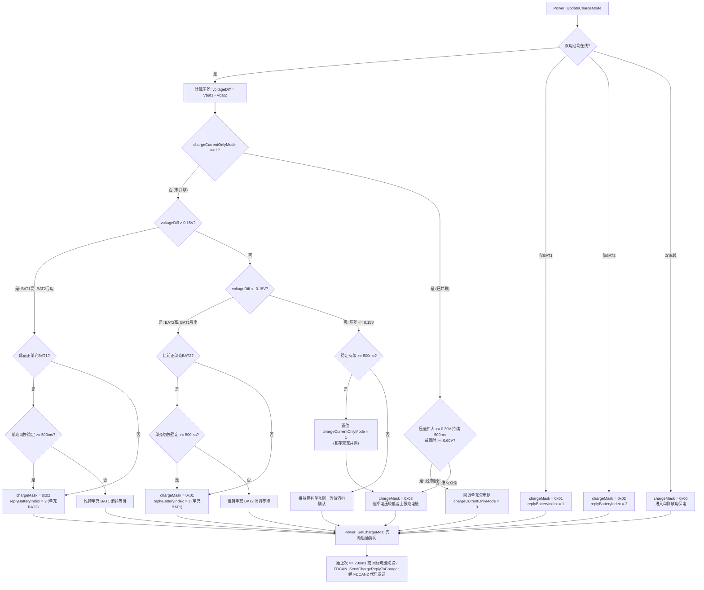

# D-Y 双电池系统充电控制逻辑与协议交互分析

本文档详细梳理 D-Y 双电池智能电源管理系统的当前充电逻辑，重点分析**检测到充电桩 CAN 消息和小脑充电指令后的全套软硬件响应时序、安全保护与状态机流转机制**。

- **适用硬件版本**：V1.2 / V1.3（当前主板原理图）
- **适用固件版本**：v1.4.2+（支持无缝热接力、充电保电防倒灌协同、单充迟滞消抖、急停检测与母线遥测）
- **核心控制器**：STM32G474RBT6（ARM Cortex-M4 @ 170MHz）

---

## 1. 系统角色与通信拓扑

系统涉及三方协同与三路独立 FDCAN 总线（经典 CAN 模式，250kbps）：

```
                           +-------------------------------------+
                           |            上位机 / 小脑             |
                           |              (RK3588)               |
                           +-------------------------------------+
                                              ^
                                              | FDCAN2 (250kbps)
                                              | 指令下发 / 状态遥测 / IAP升级
                                              v
+------------------+       +-------------------------------------+       +-------------------+
|   电池包 1 BMS    | <---> |            STM32G474RBT6            | <---> |    外部充电桩     |
|     (BAT1)       | FDCAN1|          (双电池电源管理控制器)        | FDCAN2|     (Charger)     |
+------------------+       +-------------------------------------+       +-------------------+
                                              ^
                                              | FDCAN3 (250kbps)
                                              | 电池包 2 专线通信
                                              v
                                   +---------------------+
                                   |     电池包 2 BMS    |
                                   |       (BAT2)        |
                                   +---------------------+
```

> **拓扑总线职责说明**：  
> - **FDCAN1**（物理引脚 `PA11`/`PA12`）：专用于连接 **电池 1 (BAT1) BMS**，专线专通；  
> - **FDCAN2**（物理引脚 `PB5`/`PB13`）：共用总线，同时挂载 **上位机 / RK3588 小脑** 与 **外部充电桩 (Charger)**；  
> - **FDCAN3**（物理引脚 `PA8`/`PB4`）：专用于连接 **电池 2 (BAT2) BMS**，专线专通。

### 1.1 CAN 总线定义
1. **FDCAN1**（`PA11` RX / `PA12` TX）：专用于连接 **电池 1 (BAT1) BMS**，周期发送唤醒帧（`0x0400FF80`），接收 BAT1 内部参数（总压、电流、SOC、电芯温度、BMS MOS 状态）。
2. **FDCAN2**（`PB5` RX / `PB13` TX）：共用总线，同时连接 **上位机 / 小脑 (RK3588)** 以及 **外部充电桩 (Charger)**：
   - **对小脑**：接收充放电控制指令（`0x04500000`）、声光面板控制（`0x04600000`）及 IAP 升级请求（`0x04700000`）；向小脑周期及边沿跳变上报电源板状态遥测（`0x04400000`）、动力母线遥测（`0x04200000`）及急停状态（`0x04300000`）；
   - **对充电桩**：监听外部充电桩广播握手帧（`0x0500FF80`）；当充电模式激活时，向充电桩代理回复伪装电池参数（`0x05028000`、`0x05008000`、`0x05088000`）。
3. **FDCAN3**（`PA8` RX / `PB4` TX）：专用于连接 **电池 2 (BAT2) BMS**，周期发送唤醒帧（`0x0400FF80`），接收 BAT2 内部参数（总压、电流、SOC、电芯温度、BMS MOS 状态）。

### 1.2 硬件 MOS 与控制引脚映射
在 V1.2 / V1.3 硬件设计中，双电池采用“独立放电/预放电/回充 + 单路总充电输入”的拓扑架构：

- **单路总充电 MOS**：`PB10` (`BAT_CHARGE_MOS_Pin` / `O_Bat_C_G`)，高电平导通，背对背 MOS 连通外部充电接口与主母线 VBUS。  
  *(固件统一使用单路 `BAT_CHARGE_MOS_Pin` 控制，当任意一路充电需求激活时导通 PB10)*
- **BAT1 主放电 MOS**：`PB6` (`BAT1_DISCHARGE_MOS_Pin` / `O_Bat1_D_DSG`)，高电平导通。
- **BAT1 回充 MOS**：`PB7` (`BAT1_RECHARGE_MOS_Pin` / `O_Bat1_D_CHG`)，高电平导通。
- **BAT1 预放电 MOS**：`PB9` (`BAT1_PRE_DISCHARGE_MOS_Pin` / `O_Bat1_D_PDSG`)，高电平导通（串 400ms 限流电阻软启动缓冲）。
- **BAT2 主放电 MOS**：`PC11` (`BAT2_DISCHARGE_MOS_Pin` / `O_Bat2_D_DSG`)，高电平导通。
- **BAT2 回充 MOS**：`PC10` (`BAT2_RECHARGE_MOS_Pin` / `O_Bat2_D_CHG`)，高电平导通。
- **BAT2 预放电 MOS**：`PC12` (`BAT2_PRE_DISCHARGE_MOS_Pin` / `O_Bat2_D_PDSG`)，高电平导通（串 400ms 限流电阻软启动缓冲）。
- **外设供电 MOS**：`PA5` (`PERIPHERAL_POWER_Pin` / `O_Peripheral_G`)，高电平导通。
- **12V 隔离 DCDC 使能**：`PA7` (`DCDC_EN_12V_Pin` / `O_Enable_12V`)，低电平有效（维持小脑 RK3588 供电）。
- **24V 隔离 DCDC 使能**：`PC4` (`DCDC_EN_24V_Pin` / `O_Enable_24V`)，低电平有效（为外部 RGB 状态面板与蜂鸣器供电）。
- **反电势泄放回路 (TIM8 互补 PWM)**：`PB0` (`TIM8_CH2N`, 泄放 1 MOS Q7) 与 `PC7` (`TIM8_CH2`, 泄放 2 MOS Q27)，互补交替斩波。  
  *(注：当前固件已通过 `POWER_VBUS_RELEASE_ENABLE = 0U` 实施软关断保护，TIM8 硬件钳位拉低且 MOE 禁用，状态常驻 0x00)*
- **板载 3.3V 状态指示灯 (V1.3)**：`PB1` (LED2 系统心跳指示) 与 `PB2` (LED3 动力状态指示)。
- **急停按键输入**：`PD2` (`EMERGENCY_STOP_Pin`)，内部上拉输入，常开触点接 GND，按下接地拉低为 0（有效），带 30ms 硬件防抖。

---

## 2. 充电逻辑全时序流程

当小脑下发指令且外部充电桩接入时，系统的完整动作时序如下：

```mermaid
sequenceDiagram
    autonumber
    participant RK as 小脑 (RK3588)
    participant PLUG as 外部充电桩 (Charger)
    participant CAN2 as STM32: FDCAN2 (小脑/充电桩总线)
    participant CORE as STM32: 模式调度/状态机
    participant CAN1 as STM32: FDCAN1 (电池1专线)
    participant CAN3 as STM32: FDCAN3 (电池2专线)
    participant MOS as 硬件功率 MOS 管

    Note over RK,PLUG: 第一阶段：触发与双重仲裁（门控机制）
    RK->>CAN2: 发送充电指令 (0x04500000, Data[0]=0x01)
    CAN2->>CORE: rk_charge_mode_request = 1U (仅记录标志, 暂不切模式)
    PLUG->>CAN2: 广播充电握手帧 (0x0500FF80)
    CAN2->>CORE: 触发双条件命中: (rk_charge_mode_request && !charge_mode_active)

    Note over CORE,MOS: 第二阶段：安全隔离与母线供电维持 (Power_EnterChargeMode)
    CORE->>MOS: 关断双路预放电 MOS (PB9=0, PC12=0), 释放互斥预充索引
    CORE->>CORE: 工作模式切换: powerWorkMode = POWER_WORK_MODE_CHARGE
    CORE->>CORE: 复位消抖时钟与平衡标志 (chargeCurrentOnlyMode=0, 单充切换消抖清零)
    CORE->>CORE: charge_mode_active = 1U
    CORE->>CAN2: 反馈小脑: 已进入充电模式 (0x04500001, Data[0]=0x01)
    CORE->>CORE: 立即触发 Power_ModeTask() -> Power_UpdateChargeMode() 原子化协同配置 MOS

    Note over CORE,PLUG: 第三阶段：智能压差防环流与代理回复 (Power_UpdateChargeMode)
    loop 每次主循环 (Power_ModeTask)
        CORE->>CORE: 计算两电池压差: voltageDiff = Vbat1 - Vbat2
        alt 压差 > 0.15V (BAT1 高, BAT2 亏电需单充 BAT2)
            CORE->>CORE: 单充切换 500ms 消抖确认 (防止 IR 抬升引发跳切)
            CORE->>MOS: 【先断后通】先关断 BAT1 回充与放电 MOS (PB7=0, PB6=0)<br/>再导通 BAT2 回充与放电 MOS (PC10=1, PC11=1), 导通总充 MOS (PB10=1)
            CORE->>CAN2: 经 FDCAN2 代理回复 BAT2 参数给充电桩 (改写 0x05 前缀)
        else 压差 < -0.15V (BAT2 高, BAT1 亏电需单充 BAT1)
            CORE->>CORE: 单充切换 500ms 消抖确认
            CORE->>MOS: 【先断后通】先关断 BAT2 回充与放电 MOS (PC10=0, PC11=0)<br/>再导通 BAT1 回充与放电 MOS (PB7=1, PB6=1), 导通总充 MOS (PB10=1)
            CORE->>CAN2: 经 FDCAN2 代理回复 BAT1 参数给充电桩 (改写 0x05 前缀)
        else 压差在 0.15V 以内 (进入并联双充区间)
            alt 持续稳定 >= 500ms 消抖锁存 (chargeCurrentOnlyMode = 1)
                CORE->>MOS: 导通总充 MOS (PB10=1), 导通双路回充 (PB7/PC10=1) 与双路放电 MOS (PB6/PC11=1)
                CORE->>CAN2: 经 FDCAN2 挑选当前电压较低侧电池参数代理回复充电桩 (200ms 周期)
                CORE->>CORE: 【迟滞退出】若压差再次扩大 >= 0.30V 持续 500ms (或瞬时 >= 0.60V), 回退单充欠电侧
            else 消抖确认等待期间 (< 500ms)
                CORE->>MOS: 维持原有单充侧 MOS，杜绝 0.0V 零点振荡
            end
        end
        CORE->>CAN2: 若 MOS 或系统状态跳变, 毫秒级最高优先级上报 0x04400000; 稳态 500ms 心跳
    end

    Note over RK,PLUG: 第四阶段：退出充电模式（主动退出 / 拔枪超时）
    alt 方式 A: 小脑主动发送退出指令
        RK->>CAN2: 发送退出充电指令 (0x04500000, Data[0]=0x00)
    else 方式 B: 充电桩通信超时 (拔枪或充电机断电)
        CAN2->>CORE: 连续 3000ms 未收到 0x0500FF80 (看门狗超时)
    end
    CORE->>MOS: 立即关断总充电 MOS (PB10=0) 与双路回充 MOS (PB7=0, PC10=0)
    CORE->>CORE: 清除所有充电消抖时钟与平衡标志
    CORE->>CORE: 工作模式切回 POWER_WORK_MODE_DISCHARGE
    CORE->>CAN2: 反馈小脑: 已退出充电模式 (0x04500001, Data[0]=0x00)
    CORE->>CORE: 重新执行放电状态机 (此前维持供电电池无缝保电, 待机电池经 400ms 预充并网)
```

---

## 3. 核心机制详细剖析

### 3.1 步骤一：触发与双重仲裁（门控机制）

代码位置：[`Core/Src/fdcan.c`](file:///home/yq/ghf/workspace/D-Y-A10/Core/Src/fdcan.c#L1240-L1275)

1. **小脑请求记录**：  
   小脑通过 **FDCAN2** 发送扩展帧 `0x04500000U`（`FDCAN_RK_CHARGE_MODE_CMD_ID`），字节 0 为 `0x01`（`FDCAN_CHARGE_MODE_ENTER`）。  
   [`FDCAN_HandleRkChargeModeCommand()`](file:///home/yq/ghf/workspace/D-Y-A10/Core/Src/fdcan.c#L946-L969) 解析后，仅将请求标志位置位：
   ```c
   rk_charge_mode_request = 1U;
   ```
   > **关键设计考量**：收到小脑指令后**绝不直接开通充电硬件**。防止在充电枪未物理连接、充电桩未通电或通信异常时产生空载漏电或高压倒灌风险。

2. **充电桩握手帧检测与有效性校验**：  
   外部充电桩在 **FDCAN2** 总线上广播握手指令：`0x0500FF80U` (`FDCAN_CHARGE_MODE_CMD_ID`)。  
   STM32 的 FDCAN2 硬件过滤器配置 FilterIndex 3 捕获该 ID，并在接收时更新最近通信时间戳 `charger_can_last_rx_tick`。  
   同时，固件内置 `10.0V ~ 110.0V`（`FDCAN_BATTERY_VOLTAGE_MIN` ~ `FDCAN_BATTERY_VOLTAGE_MAX`）物理合理性范围校验，主要用于过滤 BMS 通信单包瞬态 0V 飞帧。上限设置为 110V 作为宽松阈值（实际电池系统永远达不到），确保不会因电压上限过严导致满电时误判，实际过压保护由 BMS 内部实现。

3. **双重仲裁命中切入**：  
   在 [`FDCAN_PollRkRx()`](file:///home/yq/ghf/workspace/D-Y-A10/Core/Src/fdcan.c#L1234-L1275) 中，当从 FDCAN2 收到充电桩握手帧时进行联合校验：
   ```c
   if ((rxHeader.IdType == FDCAN_EXTENDED_ID) &&
       (rxHeader.RxFrameType == FDCAN_DATA_FRAME) &&
       (rxHeader.Identifier == FDCAN_CHARGE_MODE_CMD_ID))
   {
     charger_can_last_rx_tick = now;
     if ((rk_charge_mode_request != 0U) && (charge_mode_active == 0U))
     {
       if (Power_EnterChargeMode() == HAL_OK)
       {
         charge_mode_active = 1U;
         FDCAN_SendChargeModeStatusToRk(FDCAN_CHARGE_MODE_ENTER);
       }
     }
     continue;
   }
   ```
   - 只有“小脑已下发充电指令” 且 “外部充电桩通信就绪” 时，系统才切入充电模式；
   - 切入成功后，通过 FDCAN2 向小脑回复扩展帧 `0x04500001U`（`Data[0] = 0x01`），通知上位机底盘已正式进入充电状态。

---

### 3.2 步骤二：切入充电与 MOS 原子化协同管理（`Power_EnterChargeMode` & `Power_SetChargeMos`）

代码位置：[`Core/Src/gpio.c`](file:///home/yq/ghf/workspace/D-Y-A10/Core/Src/gpio.c#L692-L819)

在切入充电模式的瞬间，系统既要保障充电回路安全防倒灌，又要保障主控小脑（RK3588）持续运行不断电：

1. **预充回路关断与状态复位**：
   ```c
   /* 关断预放电支路，释放预放电互斥索引 */
   HAL_GPIO_WritePin(BAT1_PRE_DISCHARGE_MOS_GPIO_Port, BAT1_PRE_DISCHARGE_MOS_Pin, POWER_SWITCH_OFF);
   HAL_GPIO_WritePin(BAT2_PRE_DISCHARGE_MOS_GPIO_Port, BAT2_PRE_DISCHARGE_MOS_Pin, POWER_SWITCH_OFF);
   powerPreDischargeBatteryIndex = 0U;

   /* 切换工作模式并重置消抖状态机 */
   dischargeModeEnabled = 1U;
   powerWorkMode = POWER_WORK_MODE_CHARGE;
   rechargeCurrentOnlyMode = 0U;
   chargeCurrentOnlyMode = 0U;
   chargeBalanceSteadyStartTick = 0U;
   chargeExitSteadyStartTick = 0U;
   chargeSingleSwitchSteadyStartTick = 0U;
   chargeReplyBatteryIndex = 0U;
   chargeReplyLastTxTick = HAL_GetTick() - POWER_CHARGE_REPLY_PERIOD_MS;
   ```
   - 杜绝预放电阻长期承受母线电压发热损坏风险；
   - 立即执行 `Power_ModeTask()`，交由 `Power_UpdateChargeMode()` 与 `Power_SetChargeMos()` 执行原子化硬件协同。

2. **【核心安全架构】充放电全回路 MOS 协同与“先断后通”防倒灌机制（`Power_SetChargeMos`）**：
   四足机器人小脑（RK3588）依赖母线 VBUS 经 12V 隔离 DCDC（`PA7`）供电。
   在充电模式下，系统执行严格的硬件协同控制，彻底消除了充电与母线保电间的冲突：
   - **单充 BAT1 (`chargeMask == 0x01`)**：
     1. **先断**：先彻底关断 BAT2 的回充 MOS（`PC10=0`）与放电 MOS（`PC11=0`），将 BAT2 状态置为 `POWER_BATTERY_STATE_OFF`，彻底将 BAT2 从母线上物理断开；
     2. **后通**：再导通目标充电侧 BAT1 的回充 MOS（`PB7=1`）与主放电 MOS（`PB6=1`），导通单路总充 MOS（`PB10=1`），将 BAT1 状态置为 `POWER_BATTERY_STATE_DISCHARGE`；
     3. **安全与保电兼备**：BAT1 一方面接收充电桩电流充入电芯，另一方面其主放电 MOS 直通 VBUS，稳定维持 12V DCDC 与小脑供电不断电；BAT2 完全隔离，绝无微秒级跨母线倒灌短路风险。
   - **单充 BAT2 (`chargeMask == 0x02`)**：
     1. **先断**：先彻底关断 BAT1 的回充 MOS（`PB7=0`）与放电 MOS（`PB6=0`），BAT1 置为 `OFF`；
     2. **后通**：再导通目标充电侧 BAT2 的回充 MOS（`PC10=1`）与主放电 MOS（`PC11=1`），导通单路总充 MOS（`PB10=1`），BAT2 置为 `DISCHARGE` 维持 VBUS 供电。
   - **并联双充 (`chargeMask == 0x03`)**：
     导通总充 MOS（`PB10=1`）、双路回充 MOS（`PB7=1, PC10=1`）及双路主放电 MOS（`PB6=1, PC11=1`），双电池并联满额均流快充。
   - **无充断开 (`chargeMask == 0x00`)**：
     关断双路回充 MOS（`PB7=0, PC10=0`），进入 [`Power_MaintainChargeModeVbusPower`](file:///home/yq/ghf/workspace/D-Y-A10/Core/Src/gpio.c#L616-L690)，依据 **0.30V 迟滞回差策略**（`POWER_CHARGE_VBUS_HYSTERESIS_VOLTAGE`）维持单路高电压在位电池主放电 MOS 导通，严禁双路同时放电，保小脑不断电。

---

### 3.3 步骤三：智能压差防环流与双向迟滞消抖算法（`Power_UpdateChargeMode`）

代码位置：[`Core/Src/gpio.c`](file:///home/yq/ghf/workspace/D-Y-A10/Core/Src/gpio.c#L821-L1022)

在主循环中，[`Power_ModeTask()`](file:///home/yq/ghf/workspace/D-Y-A10/Core/Src/gpio.c#L589-L614) 轮询执行。当前模式为 `POWER_WORK_MODE_CHARGE` 时，执行智能充电算法：



#### 算法策略详解：
- **准入与退出迟滞窗口（Symmetric Hysteresis）**：
  - **进入并联充电压差阈值**：`POWER_CHARGE_BALANCE_ENTER_DIFF = 0.15V`（略高于 0.10V LSB 采样步长，彻底消除采样离散跳动）；
  - **迟滞退出并联压差阈值**：`POWER_CHARGE_BALANCE_EXIT_DIFF = 0.30V`（并联充电中两电池压差若再次扩大至 0.30V 以上，自动回退至单充欠电侧，防止并联偏流）。
- **压差大（>0.15V）单充控制与单侧切换消抖（`chargeSingleSwitchSteadyStartTick`）**：
  充电电流启闭会在电池内阻上产生瞬态压降（IR Drop）。若当前正在单充 BAT1，由于电流流过 BAT1 端电压抬升，若没有消抖容易误判压差翻转而切换至 BAT2，切过去后 BAT1 电压回落又误切回 BAT1，导致高频左右横跳。为此固件引入 **500ms 单充切换消抖确认机制**，只有在压差翻转稳定持续 500ms 后才允许轮换单充侧，彻底杜绝交替跳切。
- **压差平衡消抖确认（≤0.15V 且稳定持续 500ms）**：
  两电池压差缩小至 0.15V 并在 500ms 时间窗口内保持稳定，`chargeCurrentOnlyMode` 置 1 锁存进入双充并网快充；消抖等待期间保持原有充电侧，杜绝 0.0V 零点振荡。
- **迟滞退出双充并网消抖（`chargeExitSteadyStartTick`）**：
  并联双充中，仅当压差扩大超出 0.30V 持续稳定 500ms（或瞬时严重超差 `>= 0.60V`），才执行迟滞退出双充，回退至单侧欠电快充；退出消抖确认期内维持双充，避免单包噪声误跳脱。
- **动态选优代理上报**：
  在双充状态下，系统自动挑选**当前电压较低**的那块电池作为数据源向充电桩汇报，使充电桩按照欠电电池的最佳曲线恒流输出，防止提前降流。

---

### 3.4 步骤四：向充电桩伪装代理回复（CAN 协议网关）

代码位置：[`Core/Src/fdcan.c`](file:///home/yq/ghf/workspace/D-Y-A10/Core/Src/fdcan.c#L1259-L1335)

外部充电桩并不直接与动力电池 BMS 直连通信，而是由 STM32 承担透明协议网关与数据伪装：

1. **后台周期缓存**：  
   在 FDCAN1 (BAT1) 和 FDCAN3 (BAT2) 的日常通信中，`FDCAN_CacheChargeReplyFrame()` 实时提取并缓存各电池的 3 类核心报文至 `batteryChargeReplyFrames[2][3]`：
   - **Slot 0**：电池总压/总电流状态帧（原始 ID：`0x04028000U`）
   - **Slot 1**：电池容量与基本信息帧（原始 ID：`0x04008000U`）
   - **Slot 2**：电芯最高/最低温度状态帧（原始 ID：`0x04088000U`）

2. **报文 ID 伪装映射与原子入队**：  
   当调用 [`FDCAN_SendChargeReplyToCharger()`](file:///home/yq/ghf/workspace/D-Y-A10/Core/Src/fdcan.c#L1259-L1335) 时：
   ```c
   txHeader.Identifier = (frame->id & 0x00FFFFFFU) | 0x05000000U;
   ```
   - 原电池向 STM32 汇报的内部 `0x04xxxxxx` 扩展帧，被改写前缀转换为充电桩标准认可的 `0x05xxxxxx` 帧（如 `0x05028000U`、`0x05008000U`、`0x05088000U`）；
   - 通过 **FDCAN2** 发送至外部充电桩；
   - 具备 **FDCAN2 Bus-Off 无锁快检** 与 **关中断临界区保护**（`__disable_irq()`），防止在并发入队或总线异常时发生竞态冲突。

3. **发送触发频次**：
   - 目标回复电池索引切换时（单充轮换或进入双充时）：**立即突发触发**；
   - 稳态充电时：**按 200ms（`POWER_CHARGE_REPLY_PERIOD_MS`）周期连续发送**。

---

### 3.5 步骤五：充电桩拔枪/通信超时看门狗自动退出

代码位置：[`Core/Src/fdcan.c`](file:///home/yq/ghf/workspace/D-Y-A10/Core/Src/fdcan.c#L1440-L1455)

在实际使用场景中，经常发生用户直接拔下充电枪、充电机急停断电或通信线脱落等突发情况。若控制器继续滞留在充电模式，底盘将无法恢复正常放电动作。

为此，系统引入了**充电桩通信看门狗超时自愈机制**（阈值 `FDCAN_CHARGER_CAN_TIMEOUT_MS = 3000ms`）：

```c
/* 充电桩通信超时监测：充电激活状态下连续 3 秒未收到充电桩握手帧，自动退出充电模式 */
now = HAL_GetTick();
if (charge_mode_active != 0U)
{
  uint32_t elapsed = now - charger_can_last_rx_tick;
  if ((charger_can_last_rx_tick != 0U) && (elapsed < 0x80000000U) && (elapsed >= FDCAN_CHARGER_CAN_TIMEOUT_MS))
  {
    rk_charge_mode_request = 0U;
    charge_mode_active = 0U;
    Power_ExitChargeMode();
    FDCAN_SendChargeModeStatusToRk(FDCAN_CHARGE_MODE_EXIT);
  }
}
```

- **下溢消除防护**：在判断前重新刷新 `now = HAL_GetTick()`，并加入 `elapsed < 0x80000000U` 防护，消除接收中断与任务轮询微秒级时序交错造成的无符号数反转；
- **自愈处理动作**：自动关闭总充与回充 MOS、切回放电模式、向小脑主动推送退出充电状态帧（`0x04500001`, `0x00`）。

---

### 3.6 步骤六：遥测状态即时上报小脑体系（V1.5 极简架构）

代码位置：[`Core/Src/fdcan.c`](file:///home/yq/ghf/workspace/D-Y-A10/Core/Src/fdcan.c#L453-L500, #L1456-L1580)

小脑（RK3588）需要毫秒级获知底盘硬件 MOS、电池状态及动力母线参数以执行上层安全调度：

#### 1. 电池状态与 MOS 遥测帧 (`0x04400000U`)
- **Byte 0**: BAT1 状态 —— **【V1.5 极简 3 态】**
  - `0x00`: 正常就绪 (`BATTERY_ALARM_STATUS_NORMAL`, CAN 在线且 BMS 明确允许放电)
  - `0x01`: 离线/未连接 (`BATTERY_ALARM_STATUS_OFFLINE`, CAN 掉线超时或总压 < 10V)
  - `0x02`: BMS 故障禁放 (`BATTERY_ALARM_STATUS_PROHIBITED`, BMS 明确禁放或状态未知/异常)
- **Byte 1**: BAT2 状态 —— 同上（0:就绪, 1:离线, 2:BMS禁放）
- **Byte 2**: BAT1 主放电 MOS 状态 (`bat1_discharge_mos_state`)
- **Byte 3**: BAT1 回充 MOS 状态 (`bat1_recharge_mos_state`)
- **Byte 4**: BAT2 主放电 MOS 状态 (`bat2_discharge_mos_state`)
- **Byte 5**: BAT2 回充 MOS 状态 (`bat2_recharge_mos_state`)
- **Byte 6**: 单路总充电控制 MOS 状态 (`bat_charge_mos_state`, PB10)
- **Byte 7**: 外设与系统辅助电源状态掩码 (`Power_GetAuxPowerStatusMask() & 0x07U`)：
  - `Bit 0`: 外设供电 MOS (`PA5`)
  - `Bit 1`: 12V 隔离 DCDC 使能 (`PA7`)
  - `Bit 2`: 24V 隔离 DCDC 使能 (`PC4`)
  - `Bit 3~7`: 预留固定为 0（原 Bit 3 泄放状态已迁移至 `0x04200000` Byte 4 上报）
- **上报优先级决策（双层架构）**：
  1. **最高优先级（跳变即发）**：本地 MOS 动作、辅助电源状态跳变或电池告警跳变时，`mosChangedPending` 置位，0 延时立即优先发送；遇 Tx FIFO 满保持重试挂起，绝不丢失关键硬件边沿；
  2. **基线心跳保活**：稳态下（单电或双电运行）统一以 **500ms 固定周期**（`FDCAN_BATTERY_ALARM_REPORT_PERIOD_MS`）发送心跳保活。

#### 2. 系统动力主母线遥测帧 (`0x04200000U`, 200ms 周期)
- **Byte 0-1**: 外设放电电流（`int16_t` LE, 单位 0.01A）
- **Byte 2-3**: 系统动力主母线 VBUS 电压（`uint16_t` LE, 单位 0.01V）
- **Byte 4**: 反电势高压泄放状态（`0x00`=未泄放, `0x01`=斩波泄放中）
- **Byte 5-7**: 预留固定为 `0x00`

#### 3. 急停按键状态帧 (`0x04300000U`, PD2 硬件消抖)
- **Byte 0**: 急停状态（`0x01`=急停触发锁定, `0x00`=急停释放复位）
- **Byte 1-7**: 填充 `0x00`
- **上报机制**：急停按键按下或旋转复位瞬间，立即触发跳变优先发送；急停锁定期间以 50ms 高频周期保活；正常释放时以 500ms 低频心跳保活。

---

### 3.7 步骤七：退出充电模式与放电软启动接力

代码位置：[`Core/Src/gpio.c`](file:///home/yq/ghf/workspace/D-Y-A10/Core/Src/gpio.c#L721-L741)

无论由小脑主动发起（`0x04500000` 写入 `0x00`）还是由于充电桩拔枪超时触发，系统均执行严格的恢复步骤：

1. **硬件关断**：
   - 立即关断单路总充电输入 MOS：`HAL_GPIO_WritePin(BAT_CHARGE_MOS_GPIO_Port, BAT_CHARGE_MOS_Pin, POWER_SWITCH_OFF)`；
   - 立即关断双路回充 MOS：`HAL_GPIO_WritePin(BAT1_RECHARGE_MOS_GPIO_Port, BAT1_RECHARGE_MOS_Pin, POWER_SWITCH_OFF)` 与 `PC10`；
   - 清除所有充电平衡与消抖时钟标志（`chargeCurrentOnlyMode = 0`、`chargeBalanceSteadyStartTick = 0`、`chargeSingleSwitchSteadyStartTick = 0` 等）；
2. **切回放电模式**：
   - `powerWorkMode = POWER_WORK_MODE_DISCHARGE`；
   - 立即执行一次 [`Power_ModeTask()`](file:///home/yq/ghf/workspace/D-Y-A10/Core/Src/gpio.c#L589-L614)；
3. **软启动接力**：
   - 充电期间维持供电的那一路电池保持 `POWER_BATTERY_STATE_DISCHARGE`，母线持续供电不断电；
   - 另一路处于 `POWER_BATTERY_STATE_OFF` 的电池，在恢复并网放电时，自动进入 [`Power_DischargeModeTask()`](file:///home/yq/ghf/workspace/D-Y-A10/Core/Src/gpio.c#L388-L587) 标准流程：导通预放电 MOS（400ms 缓充）$\rightarrow$ 导通主放电 MOS $\rightarrow$ 维持 200ms 重叠导通 $\rightarrow$ 断开预放电 MOS，实现两路电池安全平滑无冲击再次并网。

---

## 4. 相关 CAN 报文协议汇总表

| 报文名称 | CAN 扩展 ID | 总线接口 | 传输方向 | 周期 / 触发时机 | 关键数据载荷定义说明 |
| :--- | :--- | :--- | :--- | :--- | :--- |
| **小脑充电指令** | `0x04500000U` | **FDCAN2** | 小脑 $\rightarrow$ STM32 | 事件触发 | Byte 0: `0x01` 请求进入充电, `0x00` 退出充电 |
| **充电状态应答** | `0x04500001U` | **FDCAN2** | STM32 $\rightarrow$ 小脑 | 状态改变时回复 | Byte 0: `0x01` 已进入充电, `0x00` 已退出充电 |
| **小脑指示灯接管** | `0x04600000U` | **FDCAN2** | 小脑 $\rightarrow$ STM32 | 周期或事件 | 控制 RGB 颜色/闪烁模式及蜂鸣器鸣叫 |
| **动力母线遥测** | `0x04200000U` | **FDCAN2** | STM32 $\rightarrow$ 小脑 | 200ms 周期 | Byte 0-1: 外设放电电流 (int16_t LE, 0.01A)<br>Byte 2-3: 母线 VBUS 电压 (uint16_t LE, 0.01V)<br>Byte 4: 反电势泄放状态 (0:未泄放, 1:泄放中)<br>Byte 5-7: 预留 0x00 |
| **急停状态上报** | `0x04300000U` | **FDCAN2** | STM32 $\rightarrow$ 小脑 | 跳变即发 / 50ms(急停)/500ms(正常) | Byte 0: `0x01` 急停触发锁定, `0x00` 释放就绪<br>Byte 1-7: 预留 0x00 |
| **电池与MOS遥测** | `0x04400000U` | **FDCAN2** | STM32 $\rightarrow$ 小脑 | 500ms心跳 / **状态跳变即刻** | **[V1.5 极简架构]**<br>Byte 0-1: BAT1/BAT2 状态 (0:就绪正常, 1:离线/未连接, 2:BMS故障禁放)<br>Byte 2-5: 主放电与回充 MOS 状态<br>Byte 6: **单路总充电控制 MOS** (PB10)<br>Byte 7: **系统辅助电源掩码** (Bit0:外设MOS, Bit1:12V DCDC, Bit2:24V DCDC, Bit3~7:固定0) |
| **充电桩握手帧** | `0x0500FF80U` | **FDCAN2** | 充电桩 $\rightarrow$ STM32 | 充电桩周期广播 | 充电桩寻址、握手及接入探测帧（超时看门狗: 3000ms） |
| **代理电池总状态** | `0x05028000U` | **FDCAN2** | STM32 $\rightarrow$ 充电桩 | 200ms / 目标切换 | Byte 0-1: 电池总压 (0.1V/LSB)<br>Byte 2-3: 电池总电流 ((Raw-30000)*0.1A) |
| **代理电池信息** | `0x05008000U` | **FDCAN2** | STM32 $\rightarrow$ 充电桩 | 200ms / 目标切换 | 电池额定容量、实时 SOC 及剩余能量参数 |
| **代理电池温度** | `0x05088000U` | **FDCAN2** | STM32 $\rightarrow$ 充电桩 | 200ms / 目标切换 | 电芯最高/最低温度及温度传感器状态 |

---

## 5. 总结与设计亮点

1. **总线职责清晰化（两路专线 + 一路复合）**：  
   - **FDCAN1** 与 **FDCAN3** 分别作为电池 1 与电池 2 BMS 的专属专线，消除了跨电池总线 ID 冲突与抢占干扰；  
   - **FDCAN2** 作为复合通信总线，由 STM32 统一调度上位机小脑（RK3588）的控制遥测交互与外部充电桩的协议握手及代理回复。
2. **双条件安全门控仲裁**：  
   必须在“小脑明确下发充电指令”且“充电桩广播握手就位”双条件均满足时方可切入充电，彻底杜绝悬空插拔或误触造成的母线高压风险。
3. **充电期间母线单路保电不断电与防倒灌协同（先断后通）**：  
   在单充某侧电池时，系统严格执行“先彻底断开非充电侧电池的回充与放电 MOS，再导通目标充电侧电池的回充与放电 MOS”。目标电池既接收充电电流，又通过主放电 MOS 稳定输出 VBUS 驱动 12V DCDC 保障小脑 RK3588 持续工作；另一侧电池物理完全隔离，彻底杜绝微秒级跨母线倒灌短路。
4. **动态压差防环流与单侧切换消抖/迟滞退出**：  
   - 准入与退出迟滞（0.15V 准入，0.30V 退出）；
   - 创新引入 **500ms 单充切换消抖确认**，彻底消除充电电流启闭时内阻（IR Drop）瞬态压降变化引发的左右横跳；
   - 并在并联双充中始终挑选电压较低者向充电机汇报，兼顾快充效率与防过充保护。
5. **电池状态极简三态统一判定与全局告警刷新**：  
   统一为 0:就绪、1:离线、2:BMS故障禁放，且在 `Power_ModeTask()` 中全局周期刷新，确保放电与充电模式下上位机遥测及板载心跳灯（LED2）指示完全实时同步。
6. **透明代理伪装协议**：  
   STM32 充当协议网关，将内部 BMS 的 `0x04` 前缀自动转为工业充电桩通用的 `0x05` 标准协议，且在 FDCAN2 发送中融合了 Bus-Off 无锁快检与临界区原子入队保护。
7. **拔枪/断电看门狗超时自愈**：  
   内置 3000ms 充电桩握手帧看门狗监控，拔枪或充电机急停时 0 人工干预自动安全退出充电模式，平滑接力放电状态机。
8. **动力母线 VBUS 遥测与反电势泄放软关断**：  
   通过 `0x04200000` 周期上报 VBUS 母线电压与外设电流；反电势泄放功能提供总使能开关 `POWER_VBUS_RELEASE_ENABLE`（当前固件软关断置 0 保护），TIM8 硬件强制钳位拉低且 MOE 禁用。
9. **硬件急停保护恢复**：  
   重启 `PD2` 急停检测，带 30ms 硬件防抖，边沿跳变毫秒级突发并通过 `0x04300000` 报文双频保活上报小脑。
